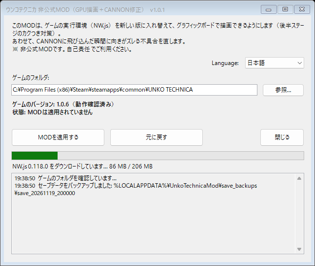
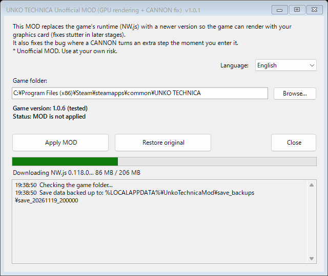

# ウンコテクニカ 非公式MOD（GPU描画＋CANNON修正）

**[English below](#english)**

Steam版『ウンコテクニカ』向けの**非公式MOD**です。ボタンを押すだけで適用でき、いつでも元に戻せます。

> [!WARNING]
> 非公式のMODです。ご利用は自己責任でお願いします。このMODについて、ゲームの開発者さんへの問い合わせはしないでください。

## ダウンロード

👉 **[最新版をダウンロード](https://github.com/Nore139/UnkoTechnicaMod/releases/latest)**（`UnkoTechnicaMod_v1.0.1.zip` をクリック）

## このMODでできること

| | 内容 |
|---|---|
| **画面のカクつき対策** | ゲームの実行環境（NW.js）を、同梱の古い版（0.29.0）から新しい版（0.118.0）に入れ替えます。PCによっては古い実行環境だとグラフィックボードが使えず、後半ステージで画面がカクつきます。新しい版では、グラフィックボードで描画できるようになります。 |
| **CANNONの向きズレ修正** | 回転するCANNONが回った直後ぴったりのタイミングで飛び込むと、もう一段（90°）余計に回ってしまう不具合を直します。ゲーム1.0.6では公式にもほぼ同じ修正が入りました。このMODは、公式の修正と重ねても二重に補正されません。 |

ステージやセーブデータなど、ゲームの中身は変えません。

## 動作環境

- Steam版『ウンコテクニカ』（動作確認済みのゲームのバージョン: **1.0.5 / 1.0.6**）
- Windows 10 / 11（64bit）
- インターネット接続（最初に約216MBをダウンロードします）
- 空き容量 約1GB

## 使い方

1. ゲームを終了しておきます。
2. ダウンロードしたZIPファイルを右クリック →「**すべて展開**」で展開します。
3. 展開したフォルダの **`UnkoTechnicaMod.bat`** をダブルクリックします。
4. 「ゲームのフォルダ」が自動で入っていることを確認して、「**MODを適用する**」を押します。
5. 「完了しました！」と出たら終わりです。いつもどおりSteamからゲームを起動してください。

元に戻すときは、同じ画面で「**元に戻す**」を押します。

警告が出たときの対処や、ゲームのアップデート後の扱いなど、詳しくは ZIP の中の `README_ja.txt` をご覧ください。

## 安全のために

- NW.js は、**NW.js公式サイト（dl.nwjs.io）からダウンロード**し、SHA-256 で本物か確認してから使います。このMODにNW.js本体は入っていません。
- インターネットへの通信は、NW.js公式サイトからのダウンロードだけです。
- MODを適用するたびに、セーブデータのバックアップを `%LOCALAPPDATA%\UnkoTechnicaMod\save_backups\` に取ります。
- MODの中身（スクリプト）は、このページの [`UnkoTechnicaMod`](UnkoTechnicaMod) フォルダで誰でも確認できます。

## 利用規約

- このMODの再配布は禁止です。紹介するときは、このページへのリンクを共有してください。（安全のため、正しいMODはこのページからのみ入手できるようにしています）
- 個人で使うための改変は自由です。改変したものを公開したい場合は、事前にご連絡ください。
- このMODを使ったことで起きた問題について、作者は責任を負いません。

## 問い合わせ

X（Twitter）: [@Nore139](https://x.com/Nore139)

---

# UNKO TECHNICA Unofficial MOD (GPU rendering + CANNON fix)

An **unofficial MOD** for the Steam version of "UNKO TECHNICA". Apply it with one button, and undo it at any time.

> [!WARNING]
> This is an unofficial MOD. Use it at your own risk. Please do not contact the game's developer about this MOD.

## Download

👉 **[Download the latest version](https://github.com/Nore139/UnkoTechnicaMod/releases/latest)** (click `UnkoTechnicaMod_v1.0.1.zip`)

## What it does

| | |
|---|---|
| **Fixes stutter** | Replaces the game's runtime (NW.js) from the bundled old version (0.29.0) with a newer one (0.118.0). On some PCs the old runtime cannot use the graphics card, which makes later stages stutter. With the newer runtime the game renders with your graphics card. |
| **Fixes the CANNON direction bug** | If you enter a rotating CANNON on the exact moment it rotates, it turns one extra step (90 degrees). This MOD fixes that. Game version 1.0.6 includes an almost identical official fix; this MOD does not double-correct when combined with it. |

Stages, save data and other game content are not changed.

## Requirements

- Steam version of "UNKO TECHNICA" (tested game versions: **1.0.5 / 1.0.6**)
- Windows 10 / 11 (64-bit)
- Internet connection (about 216 MB is downloaded the first time)
- About 1 GB of free disk space

## How to use

1. Close the game.
2. Right-click the downloaded ZIP file and choose "**Extract All...**".
3. Double-click **`UnkoTechnicaMod.bat`** in the extracted folder.
4. Check that "Game folder" has been filled in automatically, then press "**Apply MOD**".
5. When "Done!" appears, you are finished. Start the game from Steam as usual.

To undo it, press "**Restore original**" in the same window.

See `README_en.txt` in the ZIP for details (warnings you may see, what to do after a game update, etc.).

## Safety

- NW.js is **downloaded from the official NW.js site (dl.nwjs.io)** and verified with SHA-256 before use. NW.js itself is not included in this MOD.
- The only network access is that download from the official NW.js site.
- Your save data is backed up to `%LOCALAPPDATA%\UnkoTechnicaMod\save_backups\` every time you apply the MOD.
- The MOD's scripts can be reviewed by anyone in the [`UnkoTechnicaMod`](UnkoTechnicaMod) folder of this page.

## Terms of use

- Redistribution of this MOD is not allowed. To share it, please link to this page. (For your safety, the genuine MOD is only available from this page.)
- You may modify it for your own personal use. If you want to publish a modified version, please contact me first.
- The author is not responsible for any problems caused by using this MOD.

## Contact

X (Twitter): [@Nore139](https://x.com/Nore139)
